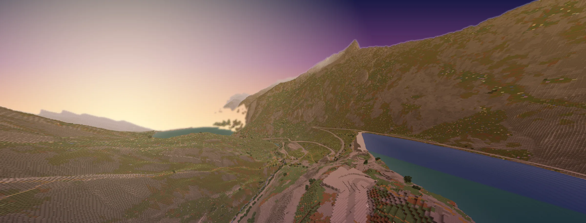
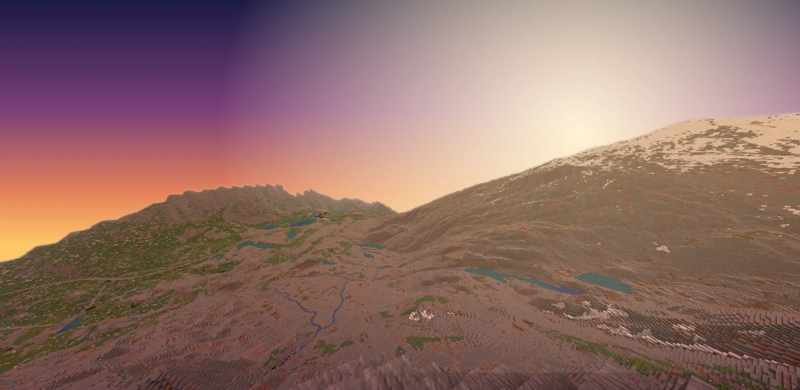
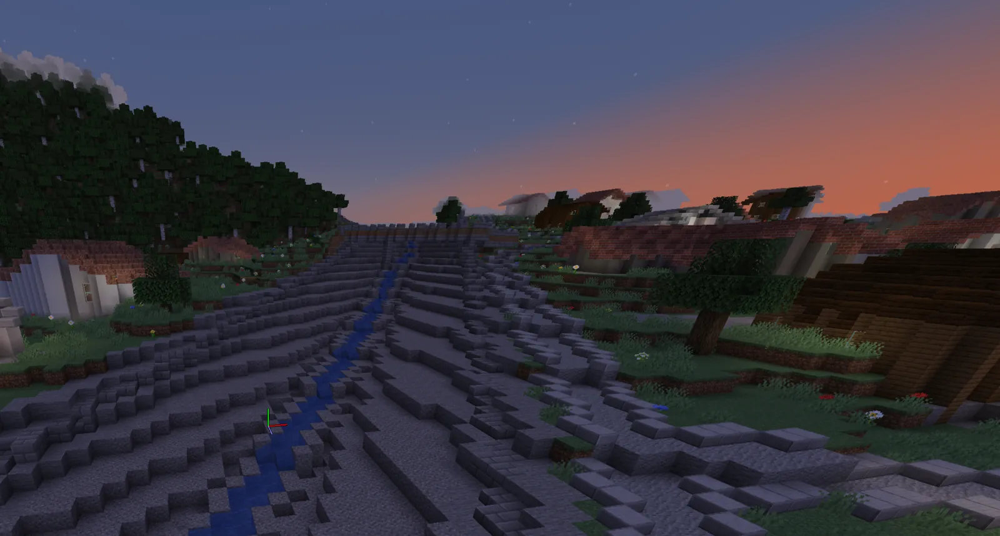
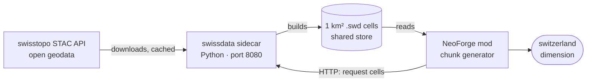

<p align="center">
  
</p>

<h1 align="center">Swiss World</h1>

<p align="center"><strong>Switzerland in Minecraft, one block per metre, built from swisstopo open data as you walk into it.</strong></p>

<p align="center">
  <a href="LICENSE"></a>
  
  
  
  
</p>

---

Swiss World is a NeoForge mod plus a small Python terrain service. Together they generate a dimension, `swissworld:switzerland`, at true scale from the federal geodata published by swisstopo. Terrain, lakes, rivers, glaciers, forests, roads, railways and buildings all come from the data. Nothing is pre-generated: chunks form around players from 1 km² data cells built on demand, then save like any vanilla chunk.

> **Status: work in progress.** Generation is tuned along the Interlaken → Brienz → Meiringen → Guttannen → Grimsel Pass test route. Elsewhere it runs, but has seen far less attention.

<table>
  <tr>
    <td width="58%"></td>
    <td></td>
  </tr>
  <tr>
    <td><sub>High Alps from above (sky re-graded)</sub></td>
    <td><sub>Village stream at dusk (in-game, untouched)</sub></td>
  </tr>
</table>

## Features

- **1:1 scale.** One block is one metre. The dimension spans y −2032…2031: `y = h − 2000` up to 3000 m, then `1000 + (h − 3000) · 0.6`, so Dufourspitze (4634 m) still fits. The Grimsel Pass (2164 m) sits at y 164.
- **Lazy generation.** The world grows outward from an origin (Interlaken Höhematte by default) as players explore. Cells are fetched from the sidecar on demand and prefetched around players.
- **Real data layers.** Elevation, surface materials coloured from orthophotos, rock faces, water bodies with lake beds, forest canopy, roads with bridges and tunnels, rail lines, and buildings with their real footprints and heights, furnished by use from the building register.
- **Vanilla blocks only.** It is server-side generation, so any 1.21.1 client can join.
- **Travel commands.** `/swiss` to enter and leave, `/swiss goto` to jump to coordinates or named places.

## How it works



| Part | Where | What it does |
|---|---|---|
| `swissdata` sidecar | [`sidecar/`](sidecar) | Downloads swisstopo tiles for the cells it is asked for, merges them into terrain, surface, water, road, rail and building layers, and writes one compressed `.swd` file per km². |
| Mod | [`mod/`](mod) | Requests cells over HTTP, reads them from the shared store and turns them into blocks. Adds the dimension and the `/swiss` commands. |

More detail: [docs/dev.md](docs/dev.md) (developer guide), [docs/sidecar-api.md](docs/sidecar-api.md) (HTTP API), [docs/swd-format.md](docs/swd-format.md) (cell format), [PLAN.md](PLAN.md) (design notes).

## Quick start

You need **Java 21** and **[uv](https://docs.astral.sh/uv/)**.

```sh
git clone https://github.com/Bissbert/swiss-world
cd swiss-world/sidecar
uv sync
uv run python -m swissdata.server        # 127.0.0.1:8080; cells go to ../store
```

In a second terminal:

```sh
cd swiss-world/mod
./gradlew runClient                      # first run: a few minutes of NeoForge setup
```

In game, run `/swiss` to step into Switzerland.

By default the sidecar only builds cells inside the development area around the test route, to avoid large downloads by accident. Set `SWISSDATA_DEV_BBOX=0` to lift that limit. Other settings (`SWISSDATA_RAW`, `SWISSDATA_STORE`, `SWISSDATA_MAX_DOWNLOADS` (at most 4), `SWISSDATA_STORE_CAP_BYTES`, `SWISSDATA_HOST`, `SWISSDATA_PORT`) are described in [docs/dev.md](docs/dev.md).

**On a server:** [`sidecar/compose.example.yml`](sidecar/compose.example.yml) shows the sidecar next to a Minecraft container that shares the store volume. Point the mod's `sidecarUrl` config at the sidecar.

**Tests:** `cd mod && ./gradlew build`, and `cd sidecar && uv run --group dev pytest -q -m 'not network'`.

## Commands

| Command | What it does |
|---|---|
| `/swiss` | Travel to Switzerland (or back out, when you are already there) |
| `/swiss back` | Leave Switzerland and return to where you came from; cancels a pending trip |
| `/swiss where` | Your position in LV95 and WGS84, elevation, and a link to map.geo.admin.ch |
| `/swiss info` | About Swiss World: data sources and the height formula |
| `/swiss goto <E> <N>` · `/swiss goto <place>` | Teleport to LV95 coordinates or a named place |
| `/swiss admin …` | Operator tools (permission level 2): `status`, `stats`, `prefetch`, `origin`, `reset` and more |

## Data

All geodata is downloaded at runtime from the official sources. **No raw data is redistributed in this repository.**

| Dataset | Used for |
|---|---|
| swissALTI3D | Terrain elevation |
| swissSURFACE3D Raster | Surface heights (forest canopy) |
| SWISSIMAGE 10 cm | Orthophotos, to colour the ground |
| swissTLM3D | Roads, railways, rivers, lakes, land cover |
| swissBUILDINGS3D 3.0 | Building footprints and heights |
| swissBATHY3D | Lake beds |
| swissNAMES3D | Place names for `/swiss goto` |
| swissBOUNDARIES3D | National border |
| GK500 lithology | Underground rock types |
| GWR (Federal Building and Dwelling Register) | Building use and number of floors |

Geodata © [swisstopo](https://www.swisstopo.admin.ch/). GWR data © Federal Statistical Office (BFS). Both are used under the Swiss federal open-government-data terms.

## Website

The project page lives in [`site/`](site): a single static HTML file with self-hosted fonts and images. Serve that folder from any static host.

## Licence

Code: [MIT](LICENSE). The Archivo typeface in `site/fonts/` is under the [SIL Open Font License](site/fonts/OFL.txt).

<sub>NOT AN OFFICIAL MINECRAFT PRODUCT. NOT APPROVED BY OR ASSOCIATED WITH MOJANG OR MICROSOFT.</sub>
